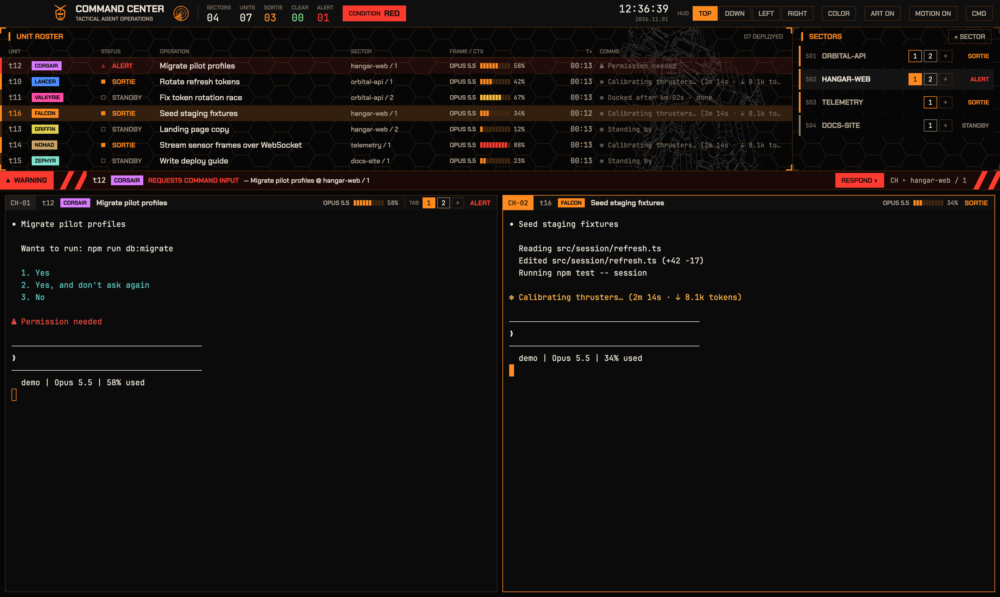

# Command Center for Herdr

A mecha-anime tactical HUD layout for the [Herdr](https://herdr.dev) desktop app: agents as deployed units with callsigns, live status, model and context gauges, a condition light, a radar, warning and mission-complete strips. Dock it top, bottom, left or right, and pick your accent color.



## Install

Copy into your Herdr app home (`~/.config/herdr-app`) without overwriting anything:

```sh
git clone https://github.com/jhin1m/herdr-command-center
cd herdr-command-center
H=~/.config/herdr-app
for p in layouts/command-center.json layouts/command-center-down.json layouts/command-center-left.json \
         layouts/command-center-side.json themes/command-center.json mods/command-center; do
  [ -e "$H/$p" ] && { echo "already exists: $H/$p"; exit 1; }
done
cp layouts/*.json "$H/layouts/" && cp themes/command-center.json "$H/themes/" && cp -R mods/command-center "$H/mods/"
herdr-app check "$H/mods/command-center" && herdr-app do layout.switch --name command-center
```

`ctrl-shift-l` switches back to your previous layout. The mod runs `hc read` on your agents' terminals every 5 s (screen text stays in memory) and the color picker rewrites `themes/command-center.json`. No network access.

See [RECIPE.md](RECIPE.md) for the full design brief.

## Credits

- Code: MIT, see [LICENSE](LICENSE).
- Chakra Petch font: SIL Open Font License 1.1 (`mods/command-center/fonts/OFL.txt`).
- `gundam-lines.png`: traced from a CC0 photo on Wikimedia Commons. Gundam is a trademark of Sotsu / Sunrise; this is an unofficial fan theme.
