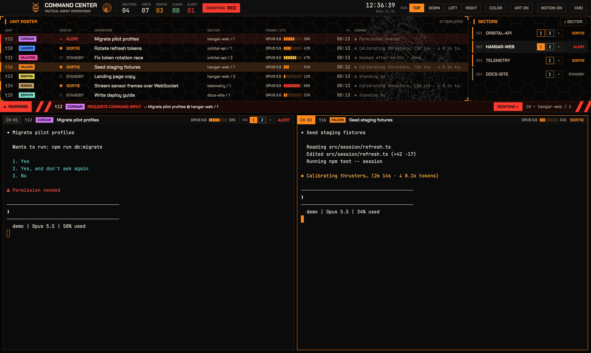

# Command Center

A mecha-anime tactical HUD for Herdr. Every agent across every space is a deployed unit with a pilot callsign, a live status, its model and context gauge, and the last line on its screen. A condition light, a spinning radar and a hazard-striped warning strip tell you when a unit needs command input; a green "MISSION COMPLETE" banner flies when one returns to base. The HUD docks on top, bottom, left or right of the live terminals, and its accent color is one click away.

## What you see

All four layouts share a 44 px top bar and the same live split tree of the shown tab, with 24 px pane headers and an 8 px inset.

- **Top bar** (`#0f0f10`): an accent-tinted mecha-head emblem, `COMMAND CENTER` (Chakra Petch 16 px bold) over `TACTICAL AGENT OPERATIONS` (9 px), a 26 px radar, counters `SECTORS / UNITS / SORTIE / CLEAR / ALERT` (JetBrains Mono 17 px), a `CONDITION` pill, a local clock `HH:MM:SS` with `YYYY.MM.DD`, the `HUD TOP DOWN LEFT RIGHT` switch, then `COLOR`, `ART ON/OFF`, `MOTION ON/OFF`, `CMD`. On macOS the bar leaves 84 px for the traffic lights; elsewhere it draws `_ □ ×` window buttons.
- **TOP** (`command-center`): a 266 px HUD block above the terminals (drag its bottom edge, 150–760 px). Inside: `UNIT ROSTER` (wide table) beside `SECTORS` (340 px, 220–560), then a 30 px alert strip.
- **DOWN** (`command-center-down`): the same HUD below the terminals, alert strip on its terminal side.
- **LEFT / RIGHT** (`command-center-left`, `command-center-side`): a 420 px HUD column (300–760) with the roster as three-line cards over `SECTORS` (230 px, 100–600); the alert strip sits above the terminals.
- **Unit roster, wide**: columns `UNIT` (address + callsign tag, 140 px), `STATUS` (84), `OPERATION` (terminal title, flex), `SECTOR` (space / tab, 150), `FRAME / CTX` (150), `T+` (72, right-aligned), `COMMS` (flex). 26 px rows with a 3 px status-colored left edge.
- **Unit roster, compact**: line 1 glyph, address, callsign tag, status word, `T+`; line 2 title and space / tab; line 3 model, gauge, percentage and the comms line.
- **Callsign tags**: 16 pilots with fixed squadron colors (FALCON `#ff8a1f`, KESTREL `#ffc23d`, LANCER `#4c8dff`, ORCA `#35d0e6`, SPECTER `#a879ff`, VALKYRIE `#ff4fa8`, NOMAD, HALBERD, RAVEN, ZEPHYR, TALON, AEGIS, CORSAIR, WRAITH, BANSHEE, GRIFFIN), dark text on the color.
- **FRAME / CTX**: the model (`OPUS 5.5`) and a 10-segment gauge with the percentage. Segments are the accent below 60 %, amber `#ffc23d` from 60 %, red from 85 %.
- **Sectors**: one 34 px row per space: `S01`, the space name in caps, its machine and `⎇ branch` under it, a chip per tab plus `+`, and the space status word. The shown space has a 3 px accent edge.
- **Pane header**: `CH-01` block (accent when focused), address, callsign, title, model gauge, branch, and on a tab's first pane a `TAB 1 2 +` strip; the status word at the right, `SHELL` for plain terminals.
- **Backdrop**: a faint hex grid in both HUD panels, and in the roster's bottom-right corner an edge-traced Unicorn Gundam at 42 % opacity.
- **Colors**: terminals `#0b0b0c`, canvas `#060607`, chrome `#0f0f10`, text `#ece4d6`, muted `#b3a691`, dim `#7a6f60`, accent `#ff8a1f` by default, blocked `#ff3b30`, done `#7fcf8a`. Borders, hover and selection are the accent mixed into the background (22 %, 10 %, 16 %).

## How it behaves

| State | Shown as |
| --- | --- |
| working | `■ SORTIE` in the accent; the glyph pulses (opacity 0.25–1, 1.4 s). Counts toward `CONDITION YELLOW` and spins the radar (2.4 s per turn). |
| blocked / error | `▲ ALERT` in red, pulsing every 0.7 s, sorted to the top of the roster. `CONDITION RED` blinks. The alert strip shows a blinking `▲ WARNING` tag, hazard stripes, `t8 [CALLSIGN] REQUESTS COMMAND INPUT — title @ space / tab`, up to four more `▲ tN` buttons and `RESPOND ▸`. |
| done | `◆ CLEAR` in green; Herdr turns it idle once you look. |
| idle | `□ STANDBY`, dim edge. |
| working → done/idle | For 8 s the alert strip shows `◆ MISSION COMPLETE`, green stripes and `tN [CALLSIGN] RETURNING TO BASE — title`. |
| nothing pending | `■ ALL UNITS NOMINAL · NO CONTACT` and the current channel `CH ▸ space / tab`. |

- Click a unit, an alert, `RESPOND ▸` or the mission banner to focus that agent (`agent.focus`). `agent.next` / `agent.prev` follow the roster order.
- Click a tab chip (sectors or pane header) to show that space and tab; `+` opens a new tab in that space; `+ SECTOR` opens a new space; a space name selects the space.
- `T+` is time in the current state, starting from the newest of the terminal's `status_ms` and the tab's `working_since` / `changed_at`, then counted locally from each observed change.
- `COMMS`, model and context come from `hc read <t> --lines 24` every 5 s, one terminal at a time, only while the window is active. The comms line is the last screen line that is not agent chrome (rules, the `❯` input box, prompts, Claude Code's footer and statusline). Model and percentage are read from a statusline containing `NN% used` / `NN% context` and `Opus|Sonnet|Haiku|Fable N.N`; without one the cell shows `—`. Screen text is kept in memory only.
- `COLOR` opens a 300×178 popup with eight accents (ORANGE, AMBER, VIOLET, CYAN, BLUE, GREEN, MAGENTA, WHITE). Picking one rewrites `themes/command-center.json` (accent, solid, working, cursor, selection, border, input, hover, selected; GREEN also moves `done` to cyan), so pane focus borders and the terminal cursor follow.
- `HUD` buttons run `layout.switch`; the current one is filled. `ART` hides the Gundam; `MOTION` stills every loop and spin. Both persist in shared state (`command-center.art`, `command-center.still`). All motion also stops while the window is inactive.

## Built from

- `layouts/command-center.json`, `-down`, `-left`, `-side`: root column (`titlebar: none`), topbar block (`window_drag`), then either a `cc-hud` column (deck row of `units` + `sectors`, then `alert`) and the `tab: active` block, or a row with the HUD column (`units` with `props.compact: true` over `sectors`) beside a column of `alert` and the tab block. The tab block frames every pane (`lone: true`) with the mod as a 24 px header.
- `mods/command-center/main.js`: one mod, roles `topbar`, `units`, `sectors`, `alert`, `pane`, `palette` (popup). Uses `agents`, `terminals`, `spaces`, `panes`, `props`, `theme`, `window`, `shared` / `setShared`, `setAgentOrder`, `hc`, `appHome`, `readTextFile`, `writeTextFile`, `openOverlay` / `closeOverlay`, `notify`, and commands `agent.focus`, `space.select`, `tab.select`, `tab.new`, `space.new`, `pane.focus`, `layout.switch`, `app.palette`, window commands.
- Native motion only: `.loop("opacity")` for pulses, `svg().spin()` for the radar. Timers: 1 s clock redraw (top bar, roster) while active, 5 s screen reads, a 1 s check that only ends the mission banner.
- Art: `emblem.svg`, `radar.svg`, `hexgrid.svg` (tinted with theme colors), `hazard.svg` / `hazard-done.svg` (2400×30 diagonal stripes clipped to 44 px), `gundam-lines.png` (900×938 white edge trace on transparency).
- `themes/command-center.json`: terminal colors and ANSI palette (warm, all hues distinguishable) plus panel colors.
- Fonts: Chakra Petch Medium/SemiBold/Bold in `mods/command-center/fonts/` (OFL, full Vietnamese coverage), terminals in bundled JetBrains Mono 13 px.

## Watch out

- `herdr-app shot` can return an old frame while the window is covered or not redrawing; look at the real window before deciding a layout froze it.
- Any layout math is flex-based; no pixel sizes come from `on_size_change`, so zoom ≠ 1 needs no correction.
- The comms filter and the model / context parsing are tuned for Claude Code's screen. Other agents show their last line and `—` for the frame.
- Callsigns are a hash of the address; two units can share one.
- The color picker overwrites the listed keys of `themes/command-center.json`; hand edits to those keys are replaced on the next pick.
- `gundam-lines.png` is traced from a CC0 photo of the life-size Unicorn Gundam statue in Odaiba. Gundam is a trademark of Sotsu / Sunrise; delete the file and the roster simply shows no art, or replace it with your own 900×938 transparent PNG.
- A second Herdr window on its own core (`HC_SESSION`, short `XDG_RUNTIME_DIR` and `HERDR_APP_HOME` paths, under ~100 bytes for the sockets) keeps a demo capture away from real work.

## Done when

- Every JSON parses; `herdr-app check mods/command-center` passes; `herdr-app status` shows no errors for all four layouts.
- With a working, a blocked, a done and an idle agent: the counters match, `CONDITION` reads RED, the radar spins, the alert strip names the blocked unit and `RESPOND ▸` focuses it for typing.
- When a working agent finishes, `MISSION COMPLETE` shows for about 8 s and returns to `ALL UNITS NOMINAL`.
- A Claude Code agent shows its model and `NN%` gauge, and its comms line is not the footer.
- `HUD` buttons switch all four layouts; the HUD edge drags in each; `COLOR` changes the pane focus border and cursor; `ART` and `MOTION` toggle and persist.
- Tab chips in the sectors panel and the pane header switch tabs, and `+` opens one.
